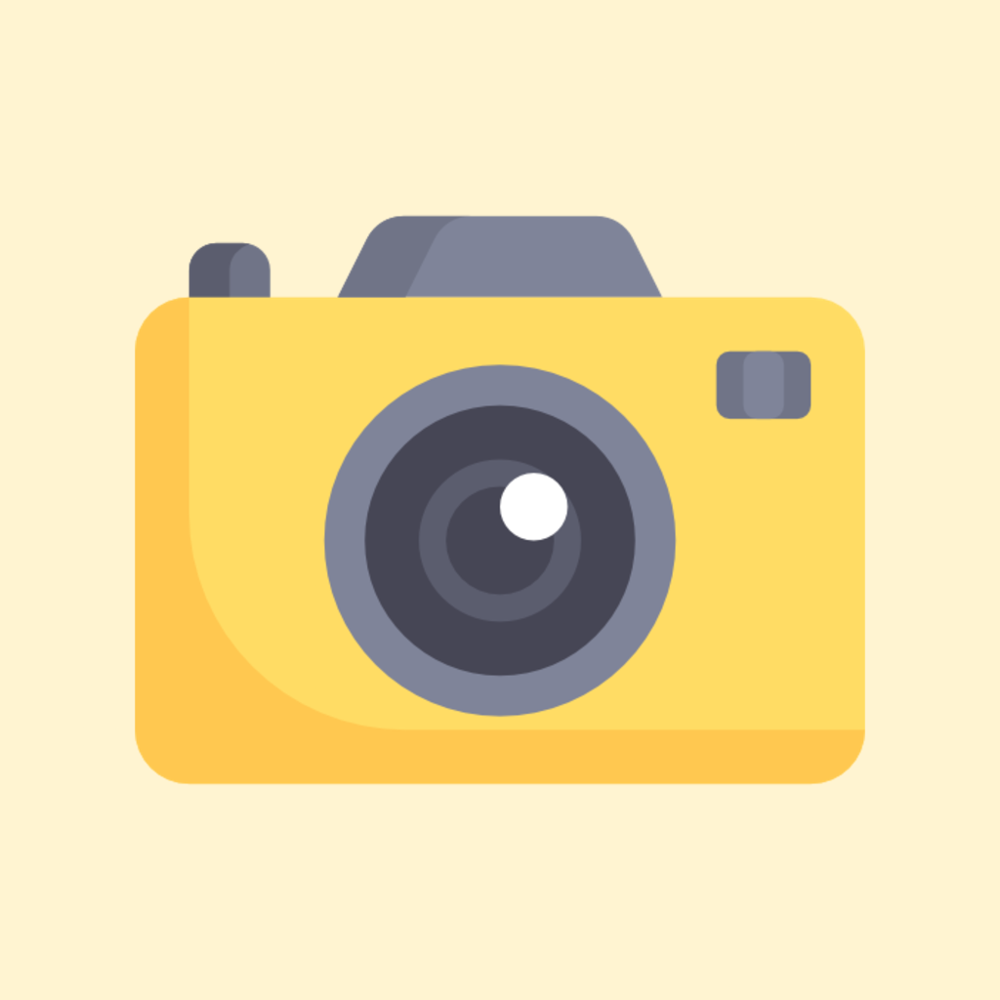
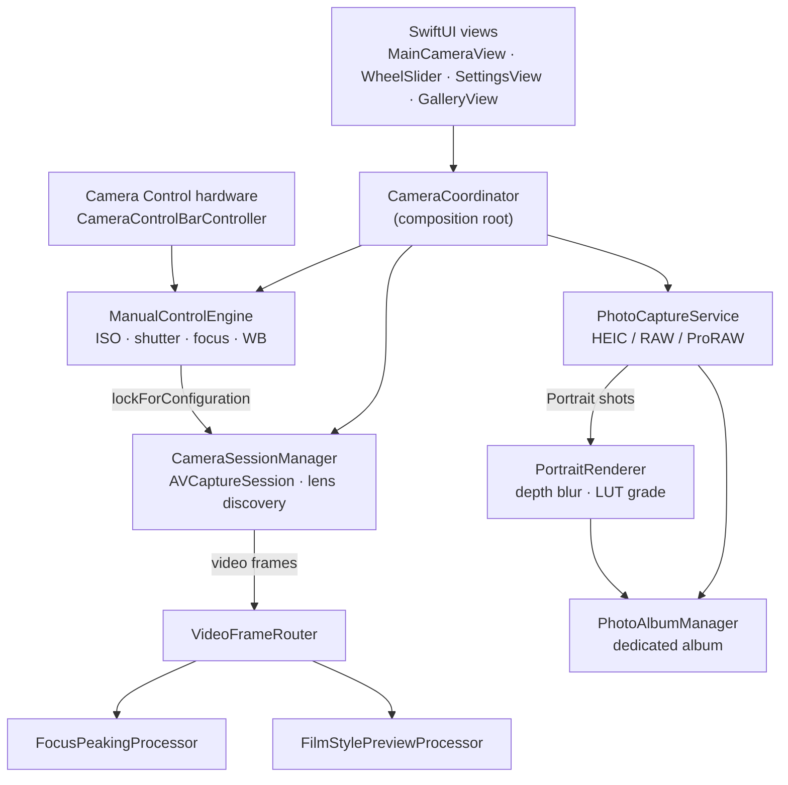

<p align="center">
  
</p>

<h1 align="center">ManualCam</h1>

<p align="center">
  A fully manual camera for iPhone. You set the exposure, and the photo you get is the exposure you set.
</p>

<p align="center">
  
  
  
</p>

---

## The problem

The stock iPhone Camera app decides almost everything for you. It meters the scene, picks an ISO and
shutter speed, and then blends several frames together (Smart HDR, Deep Fusion) into one "best" photo.
That suits snapshots. It doesn't suit someone who wants to expose deliberately, the way they would on a
DSLR or mirrorless body.

Most third-party "pro" camera apps get you part of the way, but they run into three problems:

- **Multi-frame fusion can override your settings.** If the capture pipeline is allowed to fuse frames,
  the saved HEIC can reflect an exposure the pipeline blended together rather than the ISO and shutter
  speed you dialled in. The preview looks right and the file doesn't.
- **Linear sliders don't suit photographic values.** ISO and shutter speed work in stops, where each step
  doubles or halves the light. On a linear slider, most of the travel goes to one end of the range.
- **The iPhone's lens system is built for auto mode.** The "virtual" multi-camera device that makes zoom
  feel seamless doesn't support manual focus at a set lens position. Using it for manual control can crash
  the app.

ManualCam is built around one rule: **what you dial in is what you get.**

## Features

### Manual mode

- **Full manual exposure.** ISO, shutter speed, focus and white balance (in Kelvin) are each set
  independently. Ranges are read from the active lens at runtime, never hardcoded.
- **Single-frame capture.** Photo quality prioritization is pinned to `.speed`, which turns off
  multi-frame fusion. The saved file matches the settings shown on screen.
- **Stop-based controls.** A custom tick-ruler wheel (`WheelSlider`) drives every parameter. ISO and
  shutter use a log₂ scale, so each tick is the same proportional step anywhere in the range.
- **Tap to set a new baseline.** Tap the viewfinder and the camera meters focus, exposure and white
  balance at that point, then locks those values back into manual. Every slider starts from what the
  scene asked for, and you adjust from there.
- **Real lens switching.** Every back lens on the device is available, plus any extra native crop points
  a lens reports (for example a 2× or 8× sensor crop). Each one is labelled with its 35mm-equivalent focal
  length (13mm, 24mm, 48mm, 100mm, …), calculated from the lens's real field of view. Your current
  ISO, shutter, focus and white balance carry over when you switch lenses.
- **HEIC, RAW or Apple ProRAW.** Three mutually exclusive capture formats. If plain Bayer RAW can't be
  captured at the selected zoom point, ManualCam warns you before you press the shutter and falls back
  to HEIC, so the app doesn't crash.
- **Focus peaking.** Real-time edge highlighting through a Metal-backed Core Image pipeline. When peaking
  is off, the pipeline doesn't run at all, so it costs no GPU time.
- **Camera Control support (iPhone 16 and later).** The hardware dial adjusts ISO, shutter and focus
  through the same engine as the on-screen sliders, so both always show the same values. A light press
  locks focus and exposure, and a full press takes the photo. On iPhones without Camera Control, this is
  skipped and nothing else changes.
- **Correctly oriented photos.** The interface stays in portrait, but each capture is rotated to match
  gravity, the same way the stock Camera app does it. Photos taken in landscape save upright.
- **Persistence.** Your last-used values come back when you relaunch (you can turn this off). With
  persistence off, the app meters the scene at launch and starts from that metered baseline.

### Portrait mode

Depth-based background blur, rendered after capture. Available on iPhones with dual or triple cameras.

- Captures a **depth map, a portrait effects matte and a skin segmentation matte** with each photo.
- Renders the blur with `CIDepthBlurEffect` on a background queue. The blur slider maps to the
  aperture **geometrically**, because f-numbers are stops.
- Upscales each auxiliary map with **edge-preserving upsampling** guided by the full-resolution photo.
  Without this, a ~768px depth map stretched to ~4032px produces patchy, "oil painting" blur.
- **Four looks:** Natural, Vintage, Warm and Cine. The last three are 3D LUTs (`.cube`) applied in sRGB
  with extrapolation, so colours outside the sRGB gamut in Display P3 captures aren't clipped. The
  viewfinder runs the *same* grading code live, so the preview matches the saved photo.
- **Lens row** limited to zoom factors the SDK reports as depth-capable, labelled in the usual iPhone
  convention (main lens = 1×).
- **Depth debug view** that shows the live depth map, so you can check subject separation before you
  shoot.
- **Per-shot diagnostics** showing whether depth, matte, skin matte and blur were actually delivered and
  applied. If something didn't work, you can see which step failed.

### Multi-shot timer

An intervalometer for Manual mode, set with an initial delay (0–60 s), a shot count (1–50) and an interval
(1–60 s).

- Your manual settings are **locked in the engine itself** for the whole run, so the Camera Control dial
  can't change the exposure partway through a set.
- A large countdown and "Shot X of N" progress are readable from across the room. Rising beeps play before
  every shot, and they respect the silent switch.
- The screen stays awake during a run. Backgrounding the app cancels the run cleanly, and shots already
  taken stay saved.

### Library

- Photos save to a **dedicated ManualCam album**, never loose in the camera roll.
- A built-in gallery shows only the photos ManualCam took.

## How it works



| Module | Responsibility |
|---|---|
| `CameraSessionManager` | Owns the `AVCaptureSession` on its own background queue. Finds the lenses and handles lens switches by swapping the session input. Configures and tears down Portrait's depth outputs. |
| `ManualControlEngine` | The **only** code that changes exposure, focus or white balance. Every input (on-screen sliders, the hardware dial, tap-to-meter) goes through it. Re-reads ranges on every device change. |
| `PhotoCaptureService` | Builds capture settings, rotates each shot to match gravity, and saves the result to the album. |
| `PortraitRenderer` | The post-capture Core Image pipeline: depth blur, then skin smoothing, then the film-style grade, then the HEIC encode. |
| `FocusPeakingProcessor` / `DepthPreviewProcessor` / `FilmStylePreviewProcessor` | Per-frame GPU pipelines for the viewfinder overlays. |
| `IntervalometerService` | The timer's state machine: countdown, capture, repeat. |
| `CameraCoordinator` | Connects the modules to each other and forwards their changes to SwiftUI. |

### Engineering notes

A few decisions that aren't obvious from the code alone:

- **Discrete lenses, never the virtual device (in Manual mode).** iOS's combined triple-camera device can't
  lock focus at a specific lens position (`isLockingFocusWithCustomLensPositionSupported == false`), and
  calling `setFocusModeLocked(lensPosition:)` on it throws. Manual mode therefore always runs on a single
  physical lens and swaps session inputs to change lenses. Portrait mode does use the virtual device,
  because depth only comes from there, so in Portrait the manual engine is detached and frozen.
- **Focal lengths come from field of view, as a ratio of tangents.** `tan(wideFOV/2) / tan(lensFOV/2)`
  reproduces Apple's published 13/24/100/200mm figures. Two other approaches were tried and dropped:
  dividing the angles directly gave the wrong focal lengths, and the virtual device's zoom scale gives
  numbers relative to the widest lens, not to the main 24mm lens.
- **RAW format choice lives in one rule** (`RAWPixelFormatRule`). Bayer RAW requires a zoom factor of 1.0,
  and ProRAW doesn't. The SDK lists Bayer formats *before* ProRAW formats, so taking the first available
  format silently picks Bayer. The capture path and the UI warning both use this one rule, so they can't
  disagree.
- **Tap-to-meter waits for the device to settle, using KVO.** The app watches `isAdjustingFocus`,
  `isAdjustingExposure` and `isAdjustingWhiteBalance` and waits for each to go from adjusting to settled,
  with a grace period and a timeout as fallbacks. A fixed delay, or a check that only asked "is it
  adjusting right now?", would read the values back before the device had started moving.
- **Capture orientation comes from `AVCaptureDevice.RotationCoordinator`**, which is retained and observed
  for changes, and is applied to the photo connection immediately before each shot. When the phone lies
  flat, the app keeps the last orientation it could read, the same as the stock Camera app.
- **Concurrency.** The project uses `SWIFT_DEFAULT_ACTOR_ISOLATION = MainActor`. The session manager and
  control engine are `nonisolated` and run on background queues, because AVFoundation configuration
  should never run on the main thread. Any state shared with AVFoundation delegate callbacks is protected
  by explicit locks.

## Requirements

| | |
|---|---|
| **iOS** | 18.0 or later |
| **Device** | iPhone only (portrait UI). Any back camera works for Manual mode. |
| **Portrait mode** | iPhone with a dual or triple rear camera |
| **Apple ProRAW** | iPhone Pro models that support ProRAW |
| **Camera Control** | iPhone 16 or later (optional; on-screen controls work everywhere) |
| **Xcode** | 26 or later (the project uses Swift's default-MainActor isolation setting) |

Development and testing happen on an iPhone 17 Pro.

## Getting started

1. Clone the repository and open `ManualCam.xcodeproj` in Xcode.
2. Select the **ManualCam** target, go to *Signing & Capabilities*, choose your team and change the bundle
   identifier to one you own.
3. Connect your iPhone and run. The simulator has no camera, so the app needs a real device.

To check that the project compiles without a device or signing identity:

```sh
xcodebuild -project ManualCam.xcodeproj -scheme ManualCam \
  -sdk iphonesimulator -configuration Debug CODE_SIGNING_ALLOWED=NO build
```

On first launch, ManualCam asks for camera access and for Photos access. It needs Photos access to create
its album and show its own gallery.

## Project structure

```
ManualCam/
├── Camera/     Session, manual control engine, capture, Portrait renderer, LUTs, timer
├── Peaking/    Per-frame GPU pipelines: focus peaking, depth preview, film-style preview
├── Models/     Value types: lenses, capture formats, ranges, shooting modes, timer config
├── UI/         SwiftUI screens, the WheelSlider control, preview bridge
├── Settings/   UserDefaults-backed settings and persisted camera state
├── Gallery/    In-app album grid and photo viewer
└── Luts/       .cube files for Portrait's film styles
```

## Design documents

The app was built from written specs, which are kept at the repo root:

- [`SPEC.md`](SPEC.md): the base manual camera
- [`PORTRAIT_MODE.md`](PORTRAIT_MODE.md): depth capture and post-capture bokeh
- [`MULTI_SHOT_TIMER.md`](MULTI_SHOT_TIMER.md): the intervalometer
- [`ASTRO_MODE.md`](ASTRO_MODE.md): manual exposure stacking (planned)

The shipped app differs from these specs in several places, all on purpose. [`CLAUDE.md`](CLAUDE.md)
records every difference, why it was made, and the bugs found along the way.

## Roadmap

- **Astro mode** (designed, not yet built): shoot N frames at locked manual settings, align them with
  Vision, then average them to reduce noise or take the brightest value per pixel for star trails. The
  frames are accumulated one at a time into a single float buffer, so memory use doesn't grow with the
  number of shots. The mode switcher already has a slot for it.

### Out of scope

These were left out on purpose: front camera, landscape UI, zebra stripes, presets/profiles, and the
exposure-compensation (EV) control. iOS ignores EV when exposure is fully manual; it only changes the
metering.
